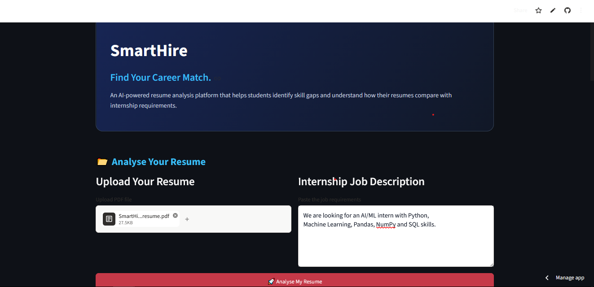
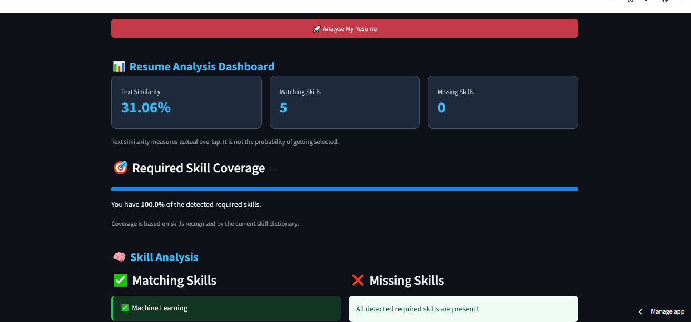
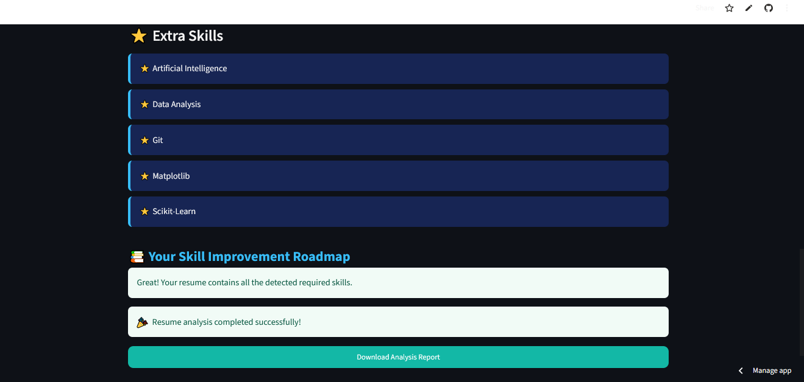
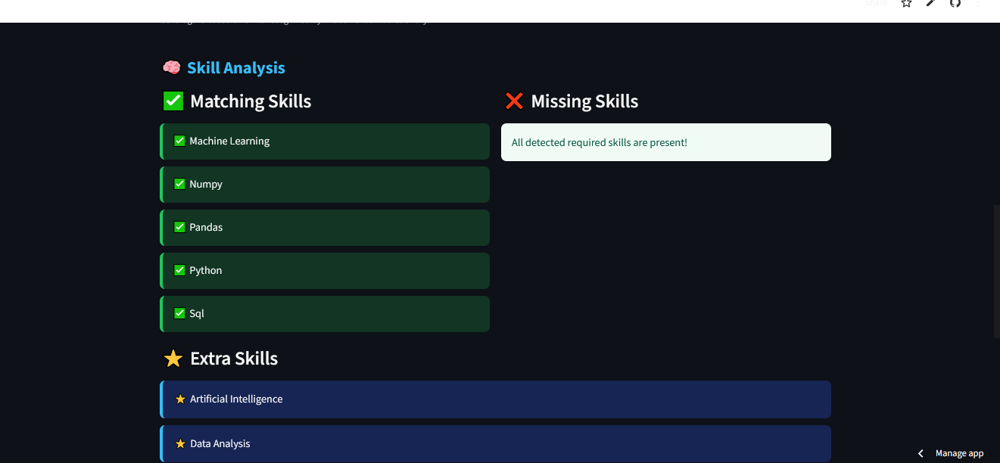

# SmartHire – AI-Powered Resume and Job Matching System

## Project Overview

SmartHire is a resume analysis web application designed to help students and job seekers understand how well their resumes match internship requirements.

It analyses an uploaded resume against a job description, identifies matching and missing skills, calculates text similarity, and provides suggestions for skill improvement.

## Problem Statement

Students often find it difficult to understand whether their resumes match the skills required for a particular internship or job role. They may not know which skills are missing or what they should improve.

## Proposed Solution

SmartHire provides an automated resume analysis system that compares resume content with job descriptions and presents useful insights through an interactive dashboard.

## Key Features

- Upload resumes in PDF format.
- Extract text from PDF resumes.
- Enter internship or job descriptions.
- Calculate text similarity using TF-IDF and cosine similarity.
- Identify matching skills and missing skills.
- Display additional skills found in the resume.
- Calculate required skill coverage.
- Generate skill improvement suggestions.
- Download the analysis report.

## Technologies Used

| Technology | Purpose |
|---|---|
| Python | Core programming language |
| Streamlit | Web application interface |
| PyPDF | PDF text extraction |
| Scikit-learn | TF-IDF and cosine similarity |
| Regular Expressions | Text cleaning and skill extraction |
| GitHub | Source code management |
| Streamlit Community Cloud | Application deployment |

## How It Works

1. The user uploads a resume in PDF format.
2. SmartHire extracts the resume text.
3. The user enters an internship or job description.
4. The application cleans the text.
5. TF-IDF converts the text into numerical vectors.
6. Cosine similarity calculates textual similarity.
7. A predefined skill dictionary identifies relevant skills.
8. The application compares resume skills with required skills.
9. The dashboard displays the analysis and improvement suggestions.

## Algorithms and Concepts

**TF-IDF (Term Frequency–Inverse Document Frequency):** Converts text into numerical representations based on word importance.

**Cosine Similarity:** Measures the similarity between the resume and job description vectors.

**Dictionary-Based Skill Extraction:** Uses predefined technical skills and regular expressions to identify skills in the text.

## Project Limitations

- Skill extraction currently depends on a predefined skill dictionary.
- The application analyses text-based PDFs; scanned resumes may not work correctly.
- Text similarity does not represent the probability of getting selected.
- Results are preliminary indicators and should not replace human evaluation.

## Future Improvements

- Expand the skill dictionary.
- Improve skill extraction using NLP techniques.
- Support additional resume formats.
- Add more detailed learning recommendations.
- Improve the matching system with advanced machine learning methods.

## Live Demo

[Open SmartHire Web Application](https://smarthire-gbmuk8huwyzscqgwcgtnl.streamlit.app/)

## Author

**Sadhiya Sulthana**

B.Tech – Artificial Intelligence and Machine Learning

## Acknowledgement

This project was developed as a hands-on learning experience to apply Python, machine learning concepts, text processing, and web application development.

## Screenshots

### Home Page

### Resume and Job Description Input

### Results Dashboard

### Skill Analysis

